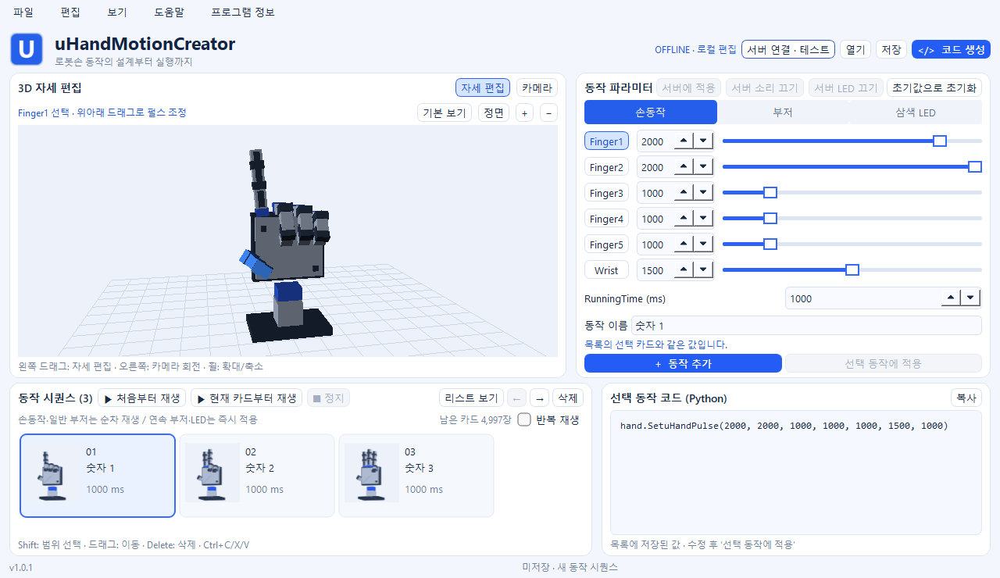
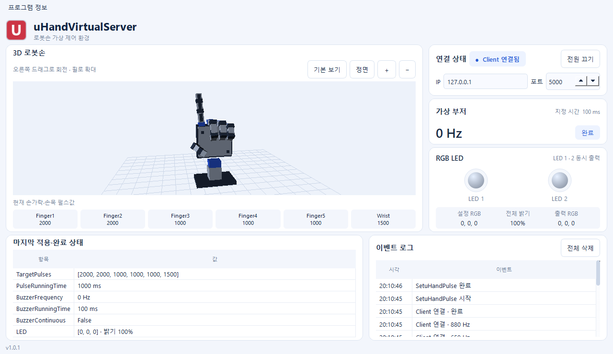
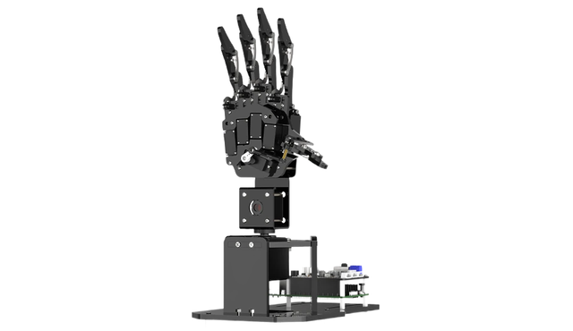
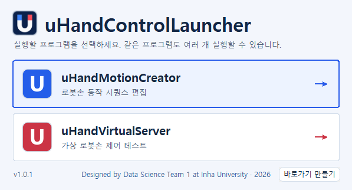

# uHandControl 1.0.1

**uHandControl은 Hiwonder uHandPi 로봇손의 동작을 만들고 실행하는 Python 프로젝트입니다.** 손동작·부저·LED를 카드로 조합하고, 실제 장비가 없어도 가상 로봇손으로 먼저 시험할 수 있습니다.

| 동작 만들기 | 가상 로봇손으로 확인하기 | 실제 로봇손에서 실행하기 |
| :---: | :---: | :---: |
| [](docs/images/creator-number-one.png) | [](docs/images/virtual-number-one.png) | [](docs/images/uhandpi-hardware.png) |
| **uHandMotionCreator**에서 검지만 펴는 ‘숫자 1’ 카드를 만듭니다. | **uHandVirtualServer**에서 같은 카드가 만드는 자세를 확인합니다. | **Hiwonder uHandPi**에 연결하면 같은 카드를 실제 장비에서 실행할 수 있습니다. |

프로젝트에 사용한 uHandPi는 Raspberry Pi 4 Model B 기반입니다. [프로젝트 장비 사양](docs/hardware-setup.md)

## 1.0.1 다운로드

가상 로봇손을 사용하려면 프로그램 소스 ZIP을 받으세요. 실물 로봇손의 microSD 카드를 준비할 때는 OS 이미지 ZIP도 필요합니다.

| 사용 목적 | 받을 파일 |
| --- | --- |
| Windows PC에서 실행 | [프로그램 소스 ZIP (GitHub)](https://github.com/SonYeongDong/uHandControl/archive/refs/tags/v1.0.1.zip)을 풀고 `uHandControlLauncher.pyw`를 실행합니다. |
| Mac에서 실행 | 같은 [프로그램 소스 ZIP (GitHub)](https://github.com/SonYeongDong/uHandControl/archive/refs/tags/v1.0.1.zip)을 풀고 터미널에서 `python3.13 uHandControlLauncher.pyw`를 실행합니다. [Mac 설치와 첫 실행](docs/macos-testing.md) |
| 실물 로봇손의 microSD 카드 준비 | [로봇손 OS 이미지 ZIP (Google Drive)](https://drive.google.com/file/d/1L85k0Egico9ijK62MaR7uK4jhVI6I-Tf/view?usp=sharing)을 풀고 `uHandControl-1.0.1.img`를 카드에 기록합니다. ZIP과 IMG 각각의 SHA-256 및 기록 방법은 [실물 설치 가이드](docs/hardware-setup.md)에 있습니다. |

## Windows와 macOS에서 첫 동작 실행하기

프로젝트를 쓰기 가능한 폴더에 준비하고, Tkinter가 포함된 64비트 Python 3.13을 준비하세요. Mac은 macOS 14 이상이 필요합니다. 첫 설치에는 인터넷 연결이 필요합니다.

압축을 푼 폴더에서 아래 표에 따라 `uHandControlLauncher.pyw`를 실행하세요. Windows에서는 새 실행기 하단의 **바로가기 만들기**를 누르면 전용 아이콘으로 실행할 수 있습니다. Windows 작업 관리자에서는 런처, 편집기, 가상 서버가 각각의 이름과 아이콘으로 표시됩니다. 가상 서버를 한 개 열어도 네트워크 처리를 담당하는 보조 프로세스가 함께 표시될 수 있습니다. 전용 실행 파일은 처음 실행할 때 프로젝트의 `build/windows-apps/`에 자동으로 생성됩니다.

Mac에서는 현재 소스의 런처를 열면 각 프로그램을 처음 실행할 때 전용 앱 번들이 생성됩니다. Dock과 활성 상태 보기에서 프로그램 이름과 아이콘을 확인하는 방법은 [Mac 실행 안내](docs/macos-testing.md)에 있습니다.

| 운영체제 | 실행기 열기 |
| --- | --- |
| Windows | `uHandControlLauncher.pyw`를 더블클릭합니다. 파일 연결이 되어 있지 않으면 PowerShell에서 `python uHandControlLauncher.pyw`를 실행합니다. |
| macOS | 터미널에서 `python3.13 uHandControlLauncher.pyw`를 실행합니다. [Mac 설치와 첫 실행](docs/macos-testing.md) |



**uHandControlLauncher 1.0.1 · Windows 화면 예시**

1. **가상 서버 시작** — 실행기에서 **uHandVirtualServer**를 선택합니다. 첫 실행에는 전용 Python 환경을 준비합니다. 시작음이 끝나고 **연결 대기**가 표시될 때까지 기다립니다.
2. **카드 만들기** — 같은 실행기에서 **uHandMotionCreator**를 엽니다. **손동작** 탭에서 검지 슬라이더를 옮기고 **+ 동작 추가**를 누릅니다. 또는 **열기**에서 [손동작·부저·LED 혼합 예제](projects/uhand-motion-creator/examples/sequences/mixed-demo.uhjson)를 고릅니다.
3. **가상 로봇손 움직이기** — 편집기 상단 **서버 연결·테스트 → 가상 서버·이 PC → 연결**을 누릅니다. 가상 서버의 기본 주소는 `127.0.0.1:5000`입니다. 연결음이 끝난 뒤 **처음부터 실행**을 누르면 서버 창에서 로봇손의 자세가 바뀝니다.
4. **저장** — 편집기 상단 **저장**을 눌러 `.uhjson` 파일로 보관합니다. 다음 실행부터는 이미 설치한 전용 환경을 재사용합니다.

설치가 실패하면 실행기에서 안내하는 `build/launcher.log`를 확인한 뒤 프로그램을 다시 선택하세요.

## 프로그램별 안내

| 프로그램 | 환경 | 사용 안내 |
| --- | --- | --- |
| uHandMotionCreator | Windows · macOS | 카드 편집·저장·재생, 서버 연결, Python 코드 생성. [편집 화면 따라 하기](projects/uhand-motion-creator/README.md) |
| uHandVirtualServer | Windows · macOS | 가상 3D 손, 부저, LED와 이벤트 로그 확인. [가상 서버 화면 따라 하기](projects/uhand-virtual-server/README.md) |
| uHandEmgLive | Windows | EMG 암밴드의 손동작을 판정해 가상·실물 로봇손을 움직입니다. 실행기에는 Windows에서만 나타나고, 테스트는 따로 pytest로 실행합니다. [화면과 사용 방법](projects/uhand-emg-live/README.md) |
| uHandClientModule | Windows · macOS Python | 함수 여섯 개로 가상·실물 서버 제어. [설치·예제·API 설명](projects/uhand-client-module/README.md) |
| uHandServer | 로봇손의 Raspberry Pi OS | 실물 서보·부저·LED 구동. [서버 사용 및 제조사 서비스 전환](projects/uhand-server/README.md) |

실물을 처음 준비할 때는 microSD 카드 기록, Ethernet 연결과 첫 로그인 순서대로 진행하세요. [실물 설치 가이드와 OS 이미지 배포 정보](docs/hardware-setup.md)

## 개발자 테스트

실행기로 환경을 설치한 뒤 저장소 최상위에서 아래 명령을 실행합니다. 첫 명령은 각 프로젝트와 공통 패키지의 회귀 테스트, 두 번째는 두 GUI에서 카드 저장·열기와 가상 서버 재생을 확인하는 시험입니다. 네트워크 시험은 이 PC의 루프백 주소를 사용합니다.

**Windows PowerShell**

```powershell
.\.venv\Scripts\python.exe shared\tests\run_all.py
.\.venv\Scripts\python.exe shared\tests\gui_release.py
```

**macOS 터미널**

```sh
.venv/bin/python shared/tests/run_all.py
.venv/bin/python shared/tests/gui_release.py
```

제조사 SDK 패킷 시험은 장비와 동일한 SDK 파일이 있을 때만 실행합니다. 해당 파일 경로는 환경변수 `UHAND_SDK_TEST_PATH`로 지정할 수 있습니다.

## 프로젝트 팀


**인하대학교 · 2026 Data Science Team 1**

- 손영동 (Yeong-dong Son)
- 이민지 (Min-ji Lee)
- 이상윤 (Sang-yun Lee)
- 정한결 (Han-gyeol Jeong)
- 조승준 (Seung-jun Jo)
