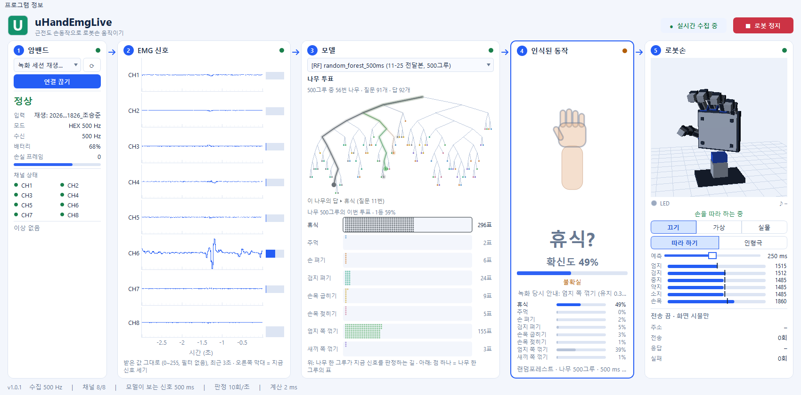

# uHandEmgLive

EMG 암밴드(Sichiray EMG PRO, 8채널)의 손동작을 모델로 판정해 로봇손을 움직이는 프로그램입니다. 신호가 로봇손에 닿기까지의 과정이 화면 한 장에 왼쪽부터 순서대로 보입니다.



```
1 암밴드 → 2 EMG 신호 → 3 모델 → 4 인식된 동작 → 5 로봇손
```

움직이는 방식은 두 가지입니다.

- **따라 하기:** 칼만 필터로 예측한 자세를 보내 로봇손이 사람 손을 따라 합니다.
- **인형극:** 인식된 동작에 해당하는 공연 파일(uHandMotionCreator로 만든 `.uhjson`)을 재생합니다.

로봇손 통신은 같은 저장소의 uHandClientModule을 쓰고, 5번 칸의 3D 손은 uHandVirtualServer와 같은 모델(`uhand-model`)입니다.
모델은 [sichiray-emg-studio](https://github.com/ufxpri/sichiray-emg-studio)에서 학습한 CNN과 팀에서 만든 랜덤포레스트, SVM 중에서 고릅니다.

## 설치와 실행

프로그램 소스 폴더에서 `uHandControlLauncher.pyw`를 열고 **uHandEmgLive**를 선택합니다. 첫 실행에 필요한 패키지는 자동으로 설치됩니다. [다운로드 및 운영체제별 실행 방법](../../README.md#101-다운로드)

고르는 곳은 데이터가 흐르는 순서대로 각 칸 안에 있습니다.

| 칸 | 고르는 것 |
|---|---|
| 1 암밴드 | 입력: 암밴드 포트 · 녹화 세션 재생 · 데모 신호. **연결**을 누르면 시작합니다. |
| 3 모델 | 판정에 쓸 모델 |
| 5 로봇손 | 로봇: 끄기(화면 시뮬만) · 가상(uHandVirtualServer) · 실물. 방식: 따라 하기 · 인형극 |

오른쪽 위의 **로봇 정지**를 누르면 로봇이 준비 자세로 돌아가 멈추고, 다시 누르면 재개합니다.

### 시연 순서

1. **장치 없이 확인:** 1번 칸에서 "데모 신호"나 "녹화 세션 재생"을 고르고 3번 칸에서 모델을 고릅니다. 화면이 흐르고 손 그림이 바뀌는지 봅니다. 데모 신호는 합성이라 판정에 의미는 없습니다.
2. **암밴드:** 수신기를 USB에 꽂고 밴드를 켠 뒤 **학습 때와 같은 위치**로 찹니다. 1번 칸이 "정상"인지, 2번 칸에 파형이 흐르는지 확인합니다.
3. **가상 로봇:** 실행기에서 uHandVirtualServer를 켜고 5번 칸에서 "가상"을 누릅니다. 아래쪽이 "연결됨 · 전송 중"이면 됩니다.
4. **실물 로봇:** 로봇손과 PC를 유선(Ethernet)으로 연결하고 5번 칸에서 "실물"을 누릅니다.

### 안 될 때

| 증상 | 확인할 것 |
|---|---|
| 1번 칸이 "연결 안 됨" / 포트 없음 | 수신기를 다시 꽂고 ⟳를 눌러 목록을 새로 고칩니다. 다른 프로그램이 포트를 잡고 있으면 끕니다. |
| 파형이 안 흐름 / "ASCII 모드" | 밴드 전원과 배터리를 확인합니다. ASCII 모드면 밴드 버튼을 **한 번** 눌러 HEX(500 Hz)로 바꿉니다(두 번 누르면 ASCII). |
| 로봇이 "연결 실패" | 로봇 서버는 **한 프로그램만** 받습니다. uHandMotionCreator의 연결을 먼저 끊으세요. 가상은 서버가 켜져 있는지, 실물은 유선 연결과 IP(192.168.61.1)를 확인합니다. |
| 판정이 왔다갔다 함 | 밴드 위치를 학습 때와 맞춥니다. `config.toml`의 `[decide] hold`를 5~6으로 올리면 인식된 동작이 덜 바뀝니다. |
| 소리를 끄고 싶음 | `config.toml`의 `[theater] buzzer = false` (프로그램을 다시 시작) |

### 명령줄

실행기가 만든 환경에서 직접 실행할 수도 있습니다. 저장소 최상위에서 실행합니다.

```powershell
.\.venv\Scripts\python.exe -m uhand_emg_live --demo --model 500그루
.\.venv\Scripts\python.exe -m uhand_emg_live --replay <세션 폴더> --model 500그루
.\.venv\Scripts\python.exe -m uhand_emg_live --port COM4 --model 조승준 --robot real --mode theater
```

설정(`config.toml`), 모델(`models/`), 공연 파일(`sequences/`)은 이 폴더(`projects/uhand-emg-live`)에서 읽습니다. 다른 위치를 쓰려면 환경변수 `UHAND_EMG_HOME`에 그 폴더를 지정합니다.

## 화면

| 칸 | 내용 |
|---|---|
| 1 암밴드 | 입력 선택과 연결, 모드·수신 속도·배터리, 채널별 상태등, 이상 목록 |
| 2 EMG 신호 | 8채널 파형. 받은 값 그대로(0~255), 최근 3초. 오른쪽 막대는 채널별 지금 신호 세기(최근 0.2초) |
| 3 모델 | 모델 선택과 그 모델의 전용 뷰. CNN은 t-SNE 신호 지도, 랜덤포레스트는 나무 한 그루의 실제 모양과 나무 투표, SVM은 동작별 1대1 대결과 마진 |
| 4 인식된 동작 | 손 그림, 동작 이름, 확신도, 동작별 확률, 착용 보정(CNN, SVM). 파란 테두리로 강조한 칸 |
| 5 로봇손 | 로봇(끄기 · 가상 · 실물)과 방식 선택, 보낸 명령대로 움직이는 3D 손(오른쪽 드래그로 회전, 휠로 확대), LED와 부저, 서보 6축 값, 연결 상태와 전송 횟수. 막대의 검은 눈금은 다음에 보낼 예측 자세 |

위쪽 줄에는 전체 상태와 **로봇 정지** 버튼이, 맨 아래 줄에는 수집 속도 · 판정 횟수 · 계산 시간 · 로봇 응답 시간이 나옵니다.

암밴드 신호에 **오류**(연결 끊김, 수신 멈춤, ASCII 모드)가 있으면 로봇은 준비 자세로 돌아가 멈춥니다.
**주의**(프레임 손실, 배터리 부족, 채널 평탄·포화·오프셋)는 표시만 합니다.

랜덤포레스트 뷰의 위쪽은 숲에서 가장 작은 나무 한 그루를 실제 가지 모양대로 그린 것입니다. 지금 신호가 뿌리에서 답까지
내려가는 길이 그 답의 색으로 켜지고, 길이 바뀌면 짙은 선으로 번쩍였다가 지난 길은 1.2초에 걸쳐 꺼집니다.
아래쪽은 모든 나무의 표입니다(점 하나 = 나무 한 그루).

SVM 뷰는 동작마다 그래프 한 줄이고, 그 동작과 다른 동작 일곱 개의 1대1 대결을 그립니다.
이 SVM 안에는 동작 두 개씩을 비교하는 판정기가 28개 있고, 가장 많이 이긴 동작이 답입니다.
가로축은 대결의 결정값입니다. 가운데 실선이 두 동작의 경계(0), 양쪽 점선이 마진(−1과 +1)이고, 그 사이 흰 띠가 마진 안쪽입니다.
마진 선 위의 원은 그 대결의 서포트 벡터입니다(오른쪽이 그 줄 동작의 것, 왼쪽이 상대 동작의 것, 클수록 많음). 이 모델의 서포트 벡터는 모두 정확히 마진 선 위에 있습니다.
테두리 있는 점이 지금 신호이고 색은 상대 동작의 색입니다. 경계 오른쪽이면 그 줄의 동작이 이긴 것이고, 경계에서 떨어진 거리가 마진 값입니다. 줄 오른쪽 끝에는 승수와, 그 동작에 가장 불리한 대결의 결정값이 나옵니다(양수면 모든 대결을 이긴 것).
특징 644개를 2차원으로 줄여 점을 찍는 방식은 쓰지 않았습니다. 그렇게 하면 지금 신호가 엉뚱한 동작 근처에 찍히는 일이 절반 가까이 됐기 때문입니다. 결정값을 축으로 쓰면 줄이는 과정이 없어 그림이 계산과 같습니다.

## 로봇이 움직이는 방식

1. 동작마다 로봇 자세(서보 6축)를 `config.toml`의 `[poses]`에 정해 둡니다.
2. 판정(0.1초마다)의 확률로 자세들을 섞어 목표 자세를 만듭니다.
3. 축마다 위치와 속도를 추적하는 칼만 필터에 넣습니다. 확신이 낮을수록 천천히 따라갑니다.
4. 0.25초마다 "예측 시간 뒤의 자세"를 0.25초짜리 이동 명령으로 보냅니다.

녹화 세션 4개(동작 250회)로 잰 값입니다. 동작을 시작한 뒤 새 자세의 90%에 닿는 시간과, 닿은 뒤 명령이 떨리는 정도(0.1초당 펄스)입니다.

| 방식 | 90% 도달 | 떨림 |
|---|---|---|
| 칼만 없이 모델의 평활 확률 그대로 | 0.74초 | 17 |
| 칼만 예측 250 ms (기본값: accel 12, noise 0.5) | 0.56초 | 38 |
| 칼만 예측 250 ms, 부드럽게 (accel 6, noise 1.0) | 0.78초 | 17 |

예측은 새 자세에 일찍 닿게 해 주지만 그만큼 떨림이 늘어납니다. 떨림을 같게 맞추면 이득이 없습니다.
근육 신호가 바뀌기 전에 다음 동작을 미리 아는 것은 아닙니다. 예측 시간은 5번 칸의 슬라이더로, 필터 값은 `config.toml`의 `[motion]`에서 바꿉니다.

**손목 동작 4개는 임시 자세입니다.** 로봇에는 손목 회전 1축뿐이라 굽히기·젖히기·좌우 꺾기를 그대로 따라 할 수 없습니다.
엄지의 굽힘 방향(2200 = 굽힘)도 EMGRobotHandTheater의 누락 표시 동작에서 추정한 값이니, 실물을 보며 `[poses]`를 고치세요.

## 인형극

5번 칸에서 방식을 **인형극**으로 바꾸면, 인식된 동작(4번 칸)에 해당하는 공연 파일을 카드 순서대로 반복 재생합니다.
파일 규칙과 동작은 [EMGRobotHandTheater](https://github.com/SonYeongDong/EMGRobotHandTheater)와 같게 맞췄으므로,
그 프로그램용으로 만든 파일을 그대로 씁니다.

1. uHandMotionCreator로 만든 파일을 `sequences/` 폴더에 아래 이름으로 넣습니다.
2. 방식을 인형극으로 바꿉니다. 바꿀 때마다 파일을 다시 읽으므로, 파일을 교체한 뒤에는 따라 하기로 갔다가 돌아오면 됩니다.
3. 5번 칸의 **공연 세트**에서 모든 동작의 파일을 한 번에 바꿉니다. "기본 동작"은 `sequences/`의 `action_NN.uhjson`(손가락으로 동작 번호를 나타내는 100 ms 카드)이고, "인형 동작"은 `sequences/인형 동작/` 폴더의 인형 동작 8개(`0_초기동작` ~ `7_그네타기`)입니다. `sequences/` 안에 폴더를 만들면 세트가 하나 늘어납니다. 그 폴더에서는 파일 이름 맨 앞의 숫자가 동작 번호입니다(`3_제자리걸음.uhjson`이나 `action_03.uhjson`은 3번). 폴더에 파일이 없는 동작은 `action_NN.uhjson`을 그대로 씁니다.
4. 그 아래 **동작마다 재생할 공연 파일** 목록에서 동작별로 파일을 따로 고를 수도 있습니다. "기본"은 `action_NN.uhjson`이고, 그 밖에 세트 폴더의 파일과 uHandMotionCreator의 예제(`../uhand-motion-creator/examples/sequences`)가 목록에 나옵니다. 따로 고른 결과가 어느 세트와도 다르면 공연 세트에 "직접 고름"으로 표시됩니다. 상태등은 초록이 정상, 주황이 파일 없음(대체 동작), 빨강이 손상이고, 재생 중인 장면은 파란 ▸로 표시됩니다. 고른 내용은 `sequences/_chosen.json`에 저장됩니다.
5. 목록에 없는 파일은 각 목록 맨 아래의 **＋ 파일 추가…**로 고릅니다. 고른 파일은 읽을 수 있는지 먼저 확인한 뒤 `sequences/`로 복사되고, 그 동작에 바로 적용되며 다른 동작의 목록에도 나타납니다. 읽을 수 없는 파일은 추가하지 않고 화면 맨 아래 줄에 이유를 표시합니다. 이름이 `action_NN`인 파일은 `added_action_NN`으로 복사해, 다른 동작의 기본 파일을 바꾸지 않습니다.

| 동작 | 파일 | 동작 | 파일 |
|---|---|---|---|
| 휴식 | `action_00.uhjson` | 손목 굽히기 | `action_04.uhjson` |
| 검지 펴기 | `action_01.uhjson` | 손 펴기 | `action_05.uhjson` |
| 엄지 쪽 꺾기 | `action_02.uhjson` | 주먹 | `action_06.uhjson` |
| 손목 젖히기 | `action_03.uhjson` | 새끼 쪽 꺾기 | `action_07.uhjson` |

- **장면 전환:** 다른 동작이 확정되면 진행 중인 카드를 마친 뒤 새 장면으로 넘어갑니다. 긴 카드는 전환을 그만큼 늦춥니다.
- **준비 자세:** 암밴드 신호에 오류가 있거나 판정이 1초 넘게 없으면 LED와 부저를 끄고 준비 자세로 돌아갑니다.
- **파일이 없을 때:** 그 동작만 대체 동작을 재생합니다(빨간 LED, 동작별 음, 번호를 이진수로 나타내는 손가락).
- **파일이 손상됐을 때:** 그 장면은 재생하지 않고 준비 자세에 머물며, 화면 아래에 파일 이름과 이유를 표시합니다.
- **LED · 부저 끄기:** `config.toml`의 `[theater]`에서 `led`, `buzzer`를 `false`로 둡니다. 부저를 꺼도 장면의 시간은 지킵니다.
- **번호 바꾸기:** 동작과 파일 번호의 대응은 `config.toml`의 `[theater.ids]`에 있습니다. `엄지 쭉 꺾기`(EMGRobotHandTheater 표의 2번)를 `엄지 쪽 꺾기`로 본 것은 추정입니다.

인형극에서는 칼만 예측을 쓰지 않습니다. 예측은 따라 하기에서만 동작합니다.

## 모델

`models/` 폴더의 파일이 모델 목록에 나타납니다.

| 종류 | 파일 | 입력 | 뷰 | 착용 보정 |
|---|---|---|---|---|
| CNN (스튜디오) | `*.npz` | 200 ms 창, 필터 후 | t-SNE 신호 지도 | 필요 (약 40초, 밴드를 찰 때마다) |
| 랜덤포레스트 | `*.joblib` | 500 ms 창, 특징 88개 | 실제 나무 + 나무 투표 | 없음 |
| SVM | `*.joblib` | 200 ms 창 7개(지난 0.8초), 특징 644개 | 동작별 1대1 대결과 마진 | 필요 (휴식 8초, 밴드를 찰 때마다) |

- **랜덤포레스트 파일이 두 개입니다.** 같은 이름(`random_forest_500ms.joblib`)으로 받은 두 파일의 내용이 달라 이름을 구분해 넣었습니다.
  11-25 전달본은 나무 500그루·학습 샘플 820개, 11-22 zip에 든 것은 300그루·1113개입니다.
- **`.joblib`은 허용 목록으로 읽습니다.** joblib 파일은 읽을 때 코드를 실행할 수 있는 형식이라, 랜덤포레스트는 scikit-learn 숲, SVM은 파이프라인·스케일러·SVC, 그리고 numpy 배열 클래스만 받아들입니다. 두 종류는 파일 앞부분에 적힌 클래스 이름으로 구분합니다.
- **SVM(`emg_svm_best.joblib`)은 보정 전에는 판정하지 않습니다.** 팔에 힘을 뺀 8초 동안의 신호 세기를 기준으로 삼기 때문에, 4번 칸의 **착용 보정 시작**을 먼저 눌러야 합니다. 계산 방법은 모델과 함께 받은 `emg_model.py`와 같고, 녹화 세션 22개의 판정 27,197개 중 27,196개가 그 스크립트와 같았습니다(다른 1개는 샘플 시각이 뒤로 간 지점).
- **SVM의 확률은 최근 3번 판정의 비율입니다.** 이 SVM은 라벨 하나만 내므로, 4번 칸의 확신도는 33 · 67 · 100% 중 하나로 나옵니다.
- **SVM은 학습에 들어간 사람에게만 잘 맞습니다.** 녹화 세션을 넣어 잰 정확도입니다(휴식 포함, 보정은 처음 다섯 번의 휴식). 학습에 쓰지 않은 세션에서 조승준 82 · 86 · 100%, 이상윤 60 · 95 · 100%, 정한결 65%였고, 학습에서 뺀 손영동은 다섯 세션에서 12~45%였습니다.
- **랜덤포레스트는 보정이 없습니다.** 신호 세기, 중심값, 밴드 위치가 학습 때와 다르면 정확도가 크게 떨어집니다. 학습 때와 같은 위치로 차세요.

### 모델 종류를 추가하는 방법

`src/uhand_emg_live/models/`에 파일 하나를 추가합니다. `GestureModel`(`src/uhand_emg_live/models/base.py`)을 상속하고, 모듈에 `find(models_dir)` 함수를 두면 자동으로 목록에 들어갑니다.

```python
class MyModel(GestureModel):
    gestures = ["rest", "fist", "open"]      # 확률 순서대로의 동작 이름 (gestures.py)
    view = "bars"                            # "map", "votes", "bars" 중 하나

    def feed(self, t, x):                    # t (n,) 샘플 시각, x (n, 8) 받은 값 그대로 0..255
        ...
        return [Decision(t_last, proba)]     # 새 판정이 있을 때만

def find(models_dir):
    return [ModelSpec(title, "MY", path, lambda: MyModel(path)) for path in ...]
```

모델은 번호가 아니라 **동작 이름**으로 결과를 냅니다. 번호 체계가 다른 모델도 파일 안에서 이름으로 바꾸기만 하면 같은 자세표와 화면을 씁니다.
전용 뷰가 필요하면 `src/uhand_emg_live/ui/views.py`에 위젯을 추가하고 `VIEWS`에 등록합니다.

## 폴더 구조

```text
config.toml          포트, 로봇 주소, 칼만 값, 동작별 로봇 자세
models/              모델 파일 (*.npz = CNN, *.joblib = 랜덤포레스트 · SVM)
sequences/           인형극 공연 파일 (action_NN.uhjson), 안의 폴더 하나가 공연 세트 하나
src/uhand_emg_live/
  __main__.py        실행
  engine.py          전 단계를 잇는 파이프라인 (화면 없이도 동작)
  gestures.py        동작 이름·색
  sensor/            암밴드 수신, health.py = 신호 이상 감지
  models/            모델 종류별 파일: cnn_studio.py, rf_features.py, svm_context.py
  decide/            확률 → 인식된 동작
  motion/            poses.py = 자세표와 섞기, kalman.py = 자세 예측
  robot/             sender.py = 전송 스레드, drivers.py = 따라 하기·인형극, scenes.py = 공연 파일 읽기, sim.py = 화면용 시뮬
  ui/                화면: window.py, views.py(모델 뷰), hand3d.py(3D 손), theme.py(색·글꼴)
tests/               테스트, fake_uhand.py = 가짜 로봇 서버
tools/ui_check.py    화면에 넘치는 곳이 없는지 점검
```

## 개발자 테스트

이 프로젝트의 테스트는 pytest로 실행합니다(약 40초, 46개). 저장소 최상위에서 실행합니다.

```powershell
.\.venv\Scripts\python.exe -m pip install pytest
.\.venv\Scripts\python.exe -m pytest projects\uhand-emg-live\tests
.\.venv\Scripts\python.exe projects\uhand-emg-live\tools\ui_check.py
```

`tools/ui_check.py`는 창을 띄우지 않고 상태별·크기별로 글자가 잘리는 곳을 찾고, 캡처를 `tools/_shots/`에 저장합니다.

## 확인한 것과 확인하지 못한 것 (2026-11-28)

- **확인:** 테스트 46개(Python 3.13), 녹화 세션 재생으로 전 과정, 가짜 로봇 서버로 전송·재접속과 인형극의 손동작·LED·부저 명령, 실행기에서의 설치와 실행(Windows).
- **미확인:** 실제 암밴드 연결, 실물 로봇손, macOS에서의 실행.
- **임시값:** 손목 동작 4개의 자세와 엄지의 굽힘 방향(2200 = 굽힘)은 실물을 보며 `config.toml`의 `[poses]`에서 맞춰야 합니다.

## 출처

- `sensor/`, `models/cnn_net.py`, `ui/hand_pic.py`: sichiray-emg-studio (MIT, `LICENSE.studio`)
- `ui/hand3d.py`: uHandVirtualServer의 3D 보기와 `uhand-model`
