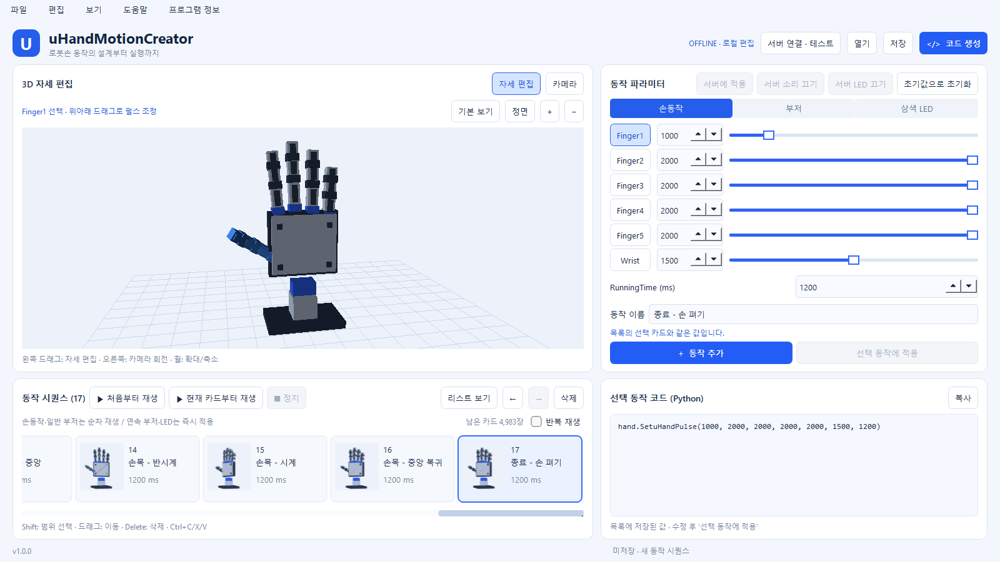
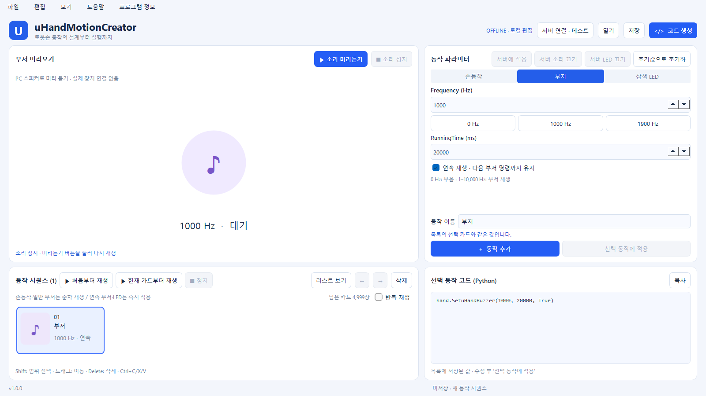
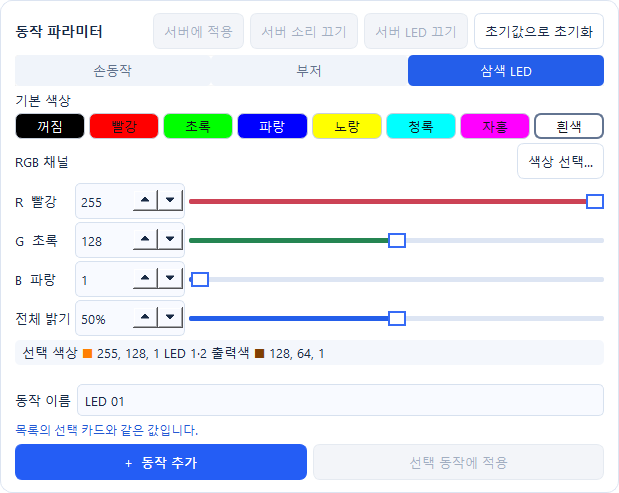
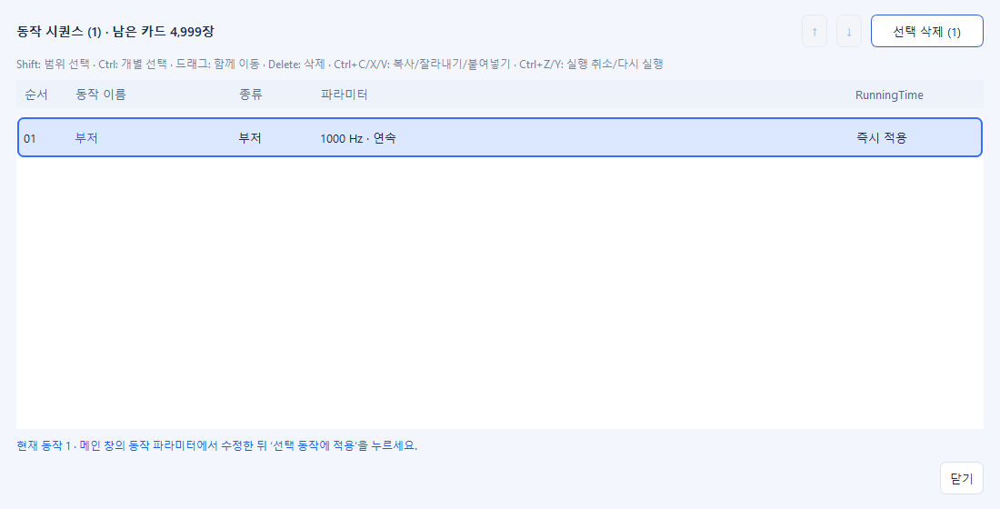
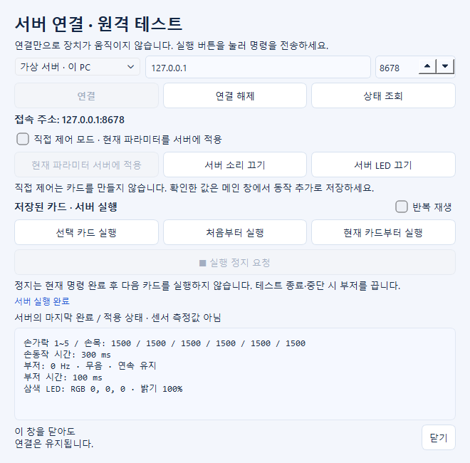
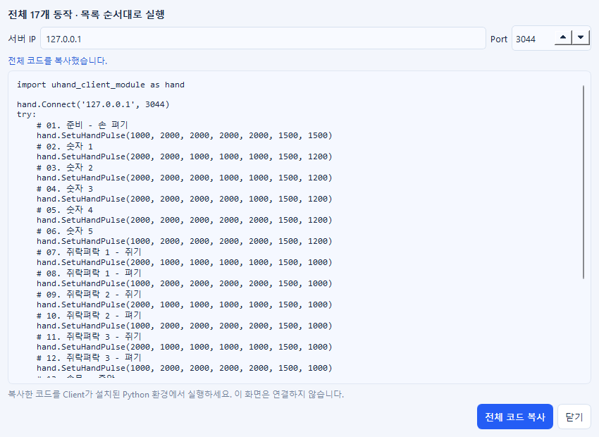

# uHandMotionCreator

Windows와 macOS에서 로봇손의 동작을 만들고 재생하는 편집기입니다. **카드 한 장**에 손 자세, 부저 소리, LED 색상 중 하나를 담습니다. 카드를 순서대로 놓으면 하나의 **동작 시퀀스**가 됩니다. 첫 연습은 로봇손이나 서버 연결 없이 진행할 수 있습니다.

## 설치와 실행

[Windows·Mac 공용 ZIP](https://github.com/SonYeongDong/uHandControl/archive/refs/tags/v1.0.0.zip)을 풀고, `run.pyw`가 있는 폴더에서 실행기를 엽니다.

- **Windows** — `run.pyw`를 더블클릭합니다. PowerShell에서는 `python run.pyw`로 열 수 있습니다.
- **macOS** — 터미널에서 `python3.13 run.pyw`를 실행합니다. [Mac 설치 안내](../../docs/macos-testing.md)

실행기에서 **uHandMotionCreator**를 선택하면 카드 편집을 시작할 수 있습니다. 가상 로봇손에 연결할 때는 **uHandVirtualServer**를 먼저 열고 **연결 대기**를 확인하세요. 첫 실행에 필요한 패키지는 자동으로 설치됩니다. [처음 실행하기](../../README.md)

## 1. 손 자세를 카드로 만들기

1. 오른쪽 **동작 파라미터 → 손동작**을 선택합니다. 손가락 슬라이더 하나를 움직이면 왼쪽 3D 손의 같은 손가락이 움직입니다. 마우스 오른쪽 버튼을 누른 채 드래그하면 시점이 회전합니다. Mac 트랙패드에서는 보조 클릭한 채 드래그합니다.
2. **RunningTime (ms)**에 자세를 바꾸는 데 걸릴 시간을 입력합니다. 예를 들어 `1000`은 1초입니다.
3. 이름을 입력하고 **+ 동작 추가**를 누릅니다. 아래 **동작 시퀀스**에 카드가 생깁니다. 기존 카드가 선택되어 있으면 그 뒤에 추가됩니다.

## 2. 소리와 빛 추가하기

**부저** 탭에서 주파수를 `1000 Hz`, 시간을 `250 ms`로 입력하고 **연속 재생**을 해제합니다. **소리 미리듣기**로 짧은 음을 들어본 뒤 **+ 동작 추가**를 누릅니다. 연속 재생을 선택하면 다음 부저 명령까지 소리가 유지됩니다. `0 Hz` 부저 카드로 무음으로 전환할 수 있습니다.

**삼색 LED** 탭에서 **빨강**을 누르고 **전체 밝기**를 `50%`로 설정합니다. 아래의 **선택 색상**과 **LED 1·2 출력색**을 비교하고 **+ 동작 추가**를 누릅니다. **색상 선택…**으로 원하는 색을 고를 수도 있습니다. LED 카드는 즉시 적용되며 다음 LED 카드까지 그 색을 유지합니다.

## 3. 순서를 바꾸고 재생하기

- 카드를 드래그해 재생 순서를 바꿉니다. **Shift**를 누른 채 다른 카드를 클릭하면 두 카드 사이의 범위를 함께 선택할 수 있습니다.
- **리스트 보기**를 열면 이름과 설정값을 표로 볼 수 있습니다. 카드를 선택하고 오른쪽 파라미터를 수정한 뒤 **선택 동작에 적용**을 누르면 해당 카드가 갱신됩니다.
- **처음부터 재생**을 눌러 순서를 확인합니다. 중간부터 확인하려면 카드를 고른 뒤 **현재 카드부터 재생**을 누릅니다. 반복해서 볼 때는 **반복 재생**을 켜고, 마치면 **정지**를 누릅니다.
- 상단 **저장**(Windows `Ctrl+S` / Mac `⌘S`)으로 시퀀스를 `.uhjson` 파일에 보관합니다. **열기**(Windows `Ctrl+O` / Mac `⌘O`)에서 파일을 고르면 카드 순서와 설정값이 복원됩니다.

## 4. 가상 서버에서 같은 카드 실행하기

1. 같은 PC에서 uHandVirtualServer를 먼저 실행하고 **연결 대기** 상태를 확인합니다. [가상 서버 화면 안내](../uhand-virtual-server/README.md)
2. 편집기 상단 **서버 연결·테스트**를 열고 **가상 서버·이 PC**를 선택합니다. 기본 IP는 `127.0.0.1`, 포트는 `5000`입니다. 화면 예시의 포트는 시험용이므로 자신의 가상 서버에 표시된 포트를 사용하세요.
3. **연결** 후 **선택 카드 실행** 또는 **처음부터 실행**을 누릅니다. 가상 서버에서 손 자세, 소리, LED가 카드 순서대로 바뀌는지 확인합니다.

## 5. Python 코드로 사용하기

상단 **코드 생성**을 누르고 실행하려는 서버의 IP와 포트를 입력합니다. **전체 코드 복사**를 눌러 Python 파일에 붙여 넣으면 같은 시퀀스를 코드로 사용할 수 있습니다. 코드를 실행할 Python 환경에는 uHandClientModule이 설치되어 있어야 합니다.
