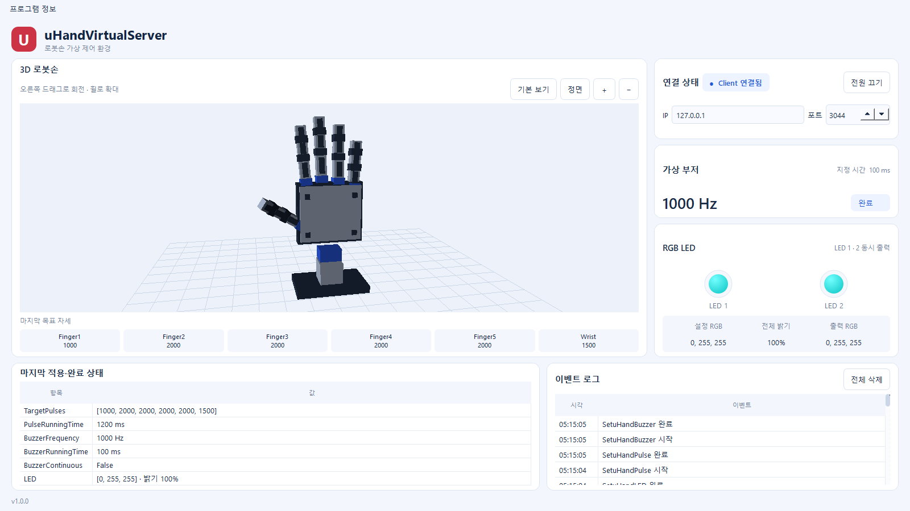
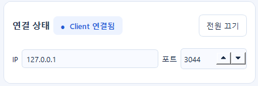
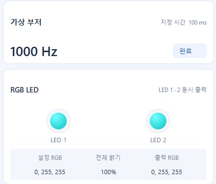
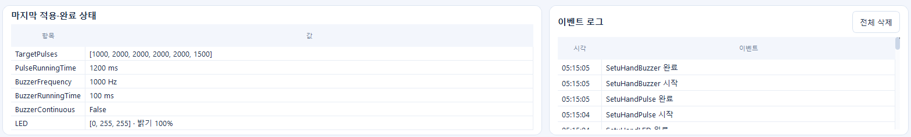

# uHandVirtualServer

실물 로봇손 없이 Windows와 macOS에서 동작을 시험하는 가상 서버입니다. uHandMotionCreator 또는 Python 클라이언트가 보낸 손동작은 3D 모델로, 부저는 PC 소리로, LED는 화면의 두 램프로 확인합니다.

## 설치와 실행

[Windows·Mac 공용 ZIP](https://github.com/SonYeongDong/uHandControl/archive/refs/tags/v1.0.0.zip)을 풀고, `run.pyw`가 있는 폴더에서 실행기를 엽니다.

- **Windows** — `run.pyw`를 더블클릭합니다. PowerShell에서는 `python run.pyw`로 열 수 있습니다.
- **macOS** — 터미널에서 `python3.13 run.pyw`를 실행합니다. [Mac 설치 안내](../../docs/macos-testing.md)

실행기에서 **uHandVirtualServer**를 선택하고, 시작음이 끝나 **연결 대기**가 표시될 때까지 기다립니다. 같은 실행기에서 **uHandMotionCreator**를 열어 연결할 수 있습니다. 첫 실행에 필요한 패키지는 자동으로 설치됩니다. [처음 실행하기](../../README.md)

## 1. 편집기와 연결하기

1. 가상 서버를 실행하고 시작음이 끝난 뒤 **연결 대기**가 표시되는지 확인합니다.
2. 같은 PC에서 uHandMotionCreator의 **서버 연결·테스트**를 열고 **가상 서버·이 PC**를 선택합니다. 가상 서버의 기본 주소는 `127.0.0.1:5000`입니다. 예시 화면은 시험용 포트 `3044`를 사용하므로 실제 창의 포트를 확인하세요.
3. 편집기에서 **연결**을 누르면 서버의 표시가 **Client 연결됨**으로 바뀝니다. 연결음이 끝나면 편집기에서 카드를 실행합니다. [편집기에서 카드 만들기](../uhand-motion-creator/README.md)

수신 주소를 바꾸려면 **전원 끄기**를 누르고 IP·포트를 입력한 뒤 **전원 켜기**를 누릅니다. 연결된 상태에서 전원을 끄면 클라이언트 연결이 끊기고 부저와 LED 출력이 꺼집니다.

## 소리로 서버 상태 확인하기

가상 서버는 다음 알림음을 PC 스피커로 재생합니다. 부저 카드를 만들거나 별도의 명령을 보내지 않아도 들리는 소리입니다.

| 언제 들리나요? | 들리는 소리 | 의미 |
| --- | --- | --- |
| 프로그램을 처음 실행하거나 **전원 켜기**를 눌렀을 때 | **도 → 미 → 솔** (523 → 659 → 784 Hz) | 서버 초기화를 마치고 연결을 받을 준비가 됐습니다. |
| uHandMotionCreator 또는 Python 클라이언트가 제어 연결을 맺을 때 | **미 → 라** (659 → 880 Hz) | 연결음이 끝나면 제어 명령을 보낼 수 있습니다. |
| 클라이언트가 연결을 해제하거나, 실행 중인 서버가 통신 단절을 감지했을 때 | **라 → 파♯ → 레** (440 → 370 → 294 Hz) | 기존 제어 연결을 정리했습니다. 해제음이 끝나면 다시 연결할 수 있습니다. |

세 경우 모두 재생 중인 부저를 멈추고 두 LED를 끈 뒤, 손가락 다섯 개와 손목을 기본 펄스값 1500으로 복귀시킵니다(500 ms). 그다음 알림음을 한 음에 175 ms씩, 음 사이에 75 ms를 두고 재생합니다.

연결 중 **전원 끄기**를 누르면 가상 전원 차단을 재현하므로 해제음 없이 부저와 LED가 꺼집니다. 다시 **전원 켜기**를 누르면 시작음이 들립니다.

## 2. 손동작과 소리·색상 확인하기

- **3D 로봇손**에서 손가락과 손목이 움직이는지 봅니다. 마우스 오른쪽 버튼을 누르고 드래그하면 시점을 돌릴 수 있고, 휠을 굴리면 확대·축소됩니다. Mac 트랙패드에서는 보조 클릭한 채 드래그해 회전하고, 두 손가락으로 스크롤해 확대·축소합니다.
- **가상 부저**에서 주파수와 재생 상태를 확인합니다. 예시의 **1000 Hz · 완료**는 해당 음이 이미 끝났다는 뜻입니다.
- **RGB LED**에서 두 램프의 색을 확인합니다. **설정 RGB**는 입력한 색, **전체 밝기**는 지정한 밝기, **출력 RGB**는 밝기를 반영한 결과입니다. 예를 들어 빨강 `255, 0, 0`을 밝기 `50%`로 보내면 출력은 `128, 0, 0`입니다.

## 3. 마지막 결과와 실행 순서 확인하기

**마지막 적용·완료 상태**에서 손동작 카드의 목표 펄스와 실행 시간, 부저와 LED의 마지막 설정을 확인합니다. 한편 **이벤트 로그**에서는 명령의 시작·완료가 시각과 함께 쌓입니다. 새 시험의 기록만 보려면 로그 오른쪽 위의 **전체 삭제**를 누른 뒤 다음 카드를 실행하세요.
